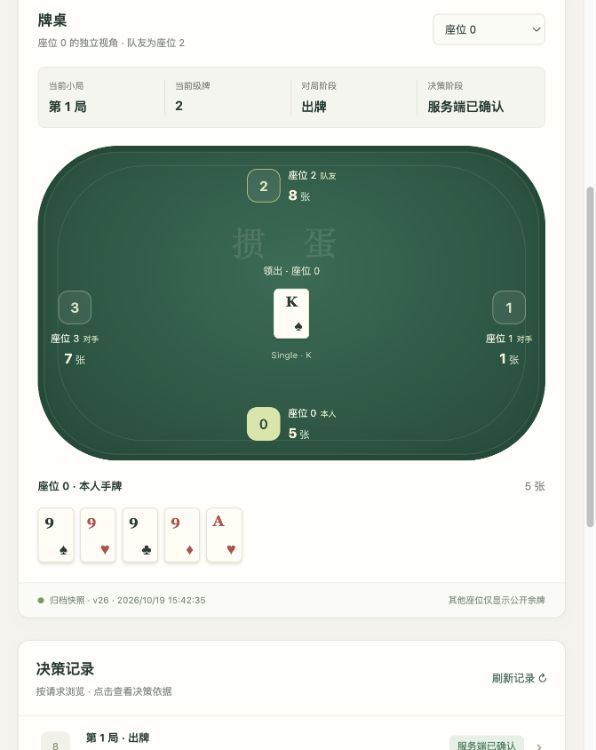
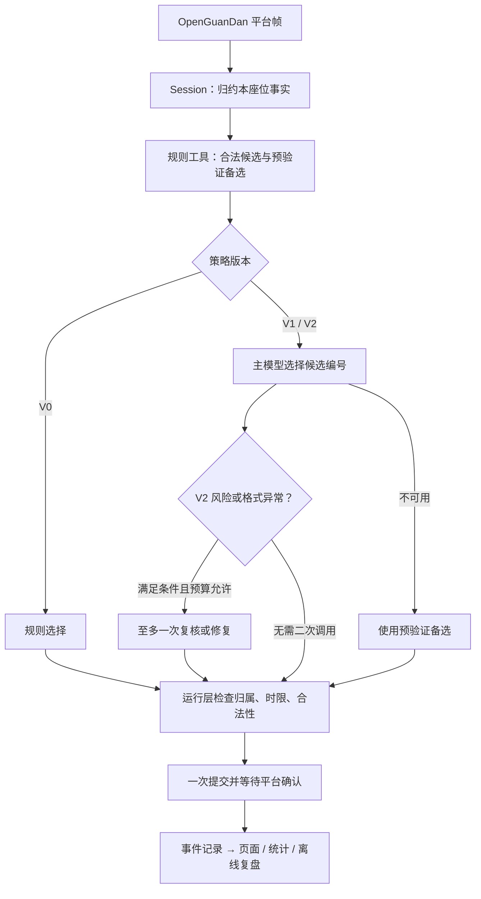

# 掼蛋 Agent · Guandan Agent

[](https://github.com/TOoSad-deep/guandan-agent/actions/workflows/checks.yml)


基于 **OpenGuanDan、LangGraph 和 DeepSeek** 的掼蛋课程项目：用规则工具生成候选，让模型在有限预算内选择动作，再由运行层校验、提交并追踪平台确认。

项目关注不完全信息牌局中的 **Agent 决策、条件复核、超时兜底与执行证据**。包含四座位运行、牌桌页面、历史查询、离线复盘及三版本实验；没有训练或微调模型。

[快速开始](docs/快速开始.md) · [架构设计](docs/架构与技术选型.md) · [实验报告](docs/交付/实验报告.md) · [开发指南](CONTRIBUTING.md) · [文档导航](docs/README.md)

## 页面预览



固定演示数据的实际浏览器截图。页面只展示所选座位的本人手牌，其他座位显示公开余牌数。无需密钥或 Java 服务即可体验：

```sh
git clone https://github.com/TOoSad-deep/guandan-agent.git
cd guandan-agent
uv sync --locked
uv run --locked python scripts/serve_b08_demo.py
```

打开 [本机演示页面](http://127.0.0.1:18080)，按 Ctrl-C 停止。需要先安装 [uv](https://docs.astral.sh/uv/getting-started/installation/)；项目固定 Python 3.12.13，uv 会按 `.python-version` 准备解释器。演示读取仓库内 fixture，不启动新比赛，也不调用模型。

## 实现了什么

- **三条决策路径**：V0 规则基线、V1 工具辅助主决策、V2 条件复核或修复。唯一合法动作直接执行。
- **合法候选与手牌工具**：以平台合法动作集为边界，分析本人余牌结构并裁剪候选；模型返回候选编号。
- **受限调用**：同一 run 共享模型额度，限制超时、并发与输出；V2 每步最多一次主调用和一次复核或修复，默认不重试。
- **按座位隔离**：每个 Session 只归约自己的接收事实；其他座位的隐藏手牌不进入该座位的决策输入。
- **提交与确认**：运行层掌握请求版本、截止时间和一次提交资格，区分建议、发送与平台确认，过期建议不可提交。
- **记录与复盘**：保存配置摘要、JSONL 事件和汇总，页面展示决策与引用，可生成无模型统计，也可点击生成指定座位的模型复盘（至多 3 条关键决策、1 次模型调用）。

## 决策如何流转



LangGraph 负责产生决策建议，Session 与 CallPort 管理运行权限和预算；模型不能直接向平台发送动作。详见[架构与技术选型](docs/架构与技术选型.md)。

| 版本 | 决策方式 | 每步在线模型调用上限 |
| --- | --- | ---: |
| V0 | 规则与手牌工具 | 0 |
| V1 | 一次主模型选择，失败使用备选 | 1 |
| V2 | 主模型 + 条件复核或格式修复 | 2 |

V2 的复核触发包括对手临近走完、使用炸弹、压过领先队友；复核与修复共用第二次调用机会。额度耗尽后使用规则备选。

## 运行与验证

页面演示只需 Python 环境。完整平台运行还需要 **JDK 21、Maven**，并从上游获取固定版本平台源码。仓库不重新分发上游源码、论文、数据集或编译后的 JAR。

启动命令覆盖 Windows PowerShell、macOS 和 Linux；Windows 的 JDK 环境设置见[快速开始](docs/快速开始.md)。CI 配置包含三个系统的离线测试、Java 构建与真实动作工具检查，是否通过以对应提交的 Actions 结果为准。

```sh
# 下载固定提交并核对 SHA-256；不构建、不启动对局
uv run --locked python -m scripts.fetch_platform

# 检查配置与执行离线测试；均不调用模型
uv run --locked guandan-agent config-check configs/local.example.toml
uv run --locked pytest

# 构建 Python 安装包
uv build
```

首次安装与平台获取需要联网。`pytest` 本身禁止网络连接；其中的平台快照检查需要先执行获取命令。Java 构建、双终端开局、V1/V2 凭证与有限额度配置、常见问题见[快速开始](docs/快速开始.md)。

## 已有实验结果与边界

B10 在本地固定平台上完成 V0/V1/V2 各一整场。受测座位固定为 0，其他三席为 V0，模型关闭思考。下表是 **历史实跑记录摘要**，不是每次 CI 的实时结果。

| 指标 | V0 | V1 | V2 |
| --- | ---: | ---: | ---: |
| 完整升级赛 / 小局 | 1 / 17 | 1 / 11 | 1 / 10 |
| 全桌提交且获平台确认 | 1,372 | 816 | 795 |
| 模型调用 | 0 | 20 main | 12 main + 8 review |
| 座位 0 预算兜底 / 非唯一请求 | 0 / 160 | 113 / 133 | 112 / 124 |
| Token 总量 | 0 | 90,833 | 73,051 |
| 团队 0 结算 | 胜 | 负 | 负 |

三场共 **2,983 次确认、40 次模型调用、163,884 tokens**，未记录未确认动作或模型错误。V2 的 8 次复核均保留原建议并获平台确认。

每版本仅一场，发牌不同、座位未轮换，且模型额度耗尽后大量使用规则备选，**不能据此判断模型提升了胜率或 V2 强于 V1**。模型理由与复盘文字仍可能包含事实错误；结构有效、动作合法、事实正确和策略更强是分别验证的指标。

公开的[冻结配置与结果摘要](docs/evidence/README.md)可对照[完整实验报告](docs/交付/实验报告.md)。全量 B10 事件、模型原回复和课程 ZIP 保存在原工作区，没有随 Git 仓库发布。High 思考档的独立文本实验见[对照报告](docs/High档24次对照复测.md)，其最大耗时超过正式在线模型超时，未作为默认配置。

## 项目结构

```text
src/guandan_agent/
  platform/       # WebSocket 接入、协议解析
  runtime/        # 座位状态、Session、RunManager、调用额度
  hand/           # 手牌工具、候选与 Java 动作引擎适配
  strategy/       # V0 / V1 / V2 策略及 LangGraph
  model/          # 模型输入、Provider 与输出校验
  recording/      # 事件写入与归档查询
  offline/        # 离线复盘与统计
  web/            # 本机 API 与静态牌桌
configs/          # 非敏感 TOML 配置与冻结实验配置
tests/            # 离线契约、单元、集成测试与固定数据
scripts/          # 平台获取/构建、演示、核验与打包
docs/             # 设计、使用、实验与开发记录
experiments/phase3/ # 早期探针与测试依赖的历史回放
```

`research/`、`runtime/`、`runs/`、`artifacts/` 是本地下载或运行产物目录，默认不提交；`src/guandan_agent/runtime/` 是正式源码。

## 后续方向

- 固定发牌、轮换座位并扩大独立整场样本，评估策略表现与不确定性。
- 继续审计配牌、牌张归属和时序等模型文字错误。
- 细化工具耗时观测，并在冻结预算下比较候选与复核策略。

项目处于课程研究与工程展示阶段，教师平台版本、API 许可、正式时限和提交格式仍需按课程要求确认。个人信息与报告模板保持占位。

## 来源与使用

平台来自 [GameAI-NJUPT/OpenGuanDan-Simulator](https://github.com/GameAI-NJUPT/OpenGuanDan-Simulator)，固定提交 `e92db7fa9d915fb318b3be78703d5ccd4a09c887`。Python 依赖及版本见 `pyproject.toml` 与 `uv.lock`。

本仓库暂未附加开源许可证；公开可读不代表授予额外使用许可。第三方材料沿用各自许可，来源及发布范围见[来源与使用范围](docs/交付/来源与使用范围.md)。欢迎通过 Issue 反馈，修改与验证方式见[贡献指南](CONTRIBUTING.md)。
