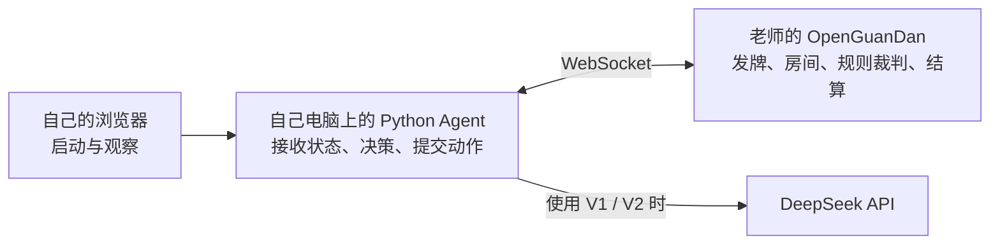

# OpenGuanDan 平台对打操作手册

编写日期：2026-10-20

使用场景：课程汇报、答辩，以及加入老师提供的 OpenGuanDan 房间进行对打。

适用前提：老师提供游戏服务器地址和房间号，Agent 在自己的电脑上运行。当前适配基于项目固定的 OpenGuanDan 版本；老师使用修改版时，以实际接口和联通结果为准。

**目前已完成接入配置模板和配置校验，尚未验证老师的实际服务器。本文中的服务器地址、房间、身份、座位和额度示例都不能代替现场安排。**

## 一、现场速查：按这六步操作

1. 向老师确认：完整 WebSocket 地址、房间号、座位、玩家身份、出牌时限、外部模型使用规则。
2. 复制并编辑 `configs/classroom-join.toml`，保持 `mode = "join"`，只配置分给自己的座位。
3. 确认使用 V0、V1 或 V2，并设置对应在线调用额度和时限。
4. 执行 `config-check`；通过后启动下面的 8001 网页服务。
5. 打开网页，选择“新运行 / 未选择”和现场配置，得到老师指示后点击“新建运行”。
6. 保持服务终端运行，观察入座、出牌和服务端确认；比赛结束后查看统计与复盘。

所有命令从项目根目录执行。以下以克隆后的目录为例；Windows 环境设置见[快速开始](../快速开始.md)：

```bash
cd guandan-agent
```

首次创建现场配置：

```bash
cp -n configs/classroom-join.example.toml configs/classroom-join.toml
```

`-n` 避免覆盖已填写的文件。

Windows PowerShell 复制配置时使用以下命令，已有配置不会被覆盖：

```powershell
if (!(Test-Path configs/classroom-join.toml)) { Copy-Item configs/classroom-join.example.toml configs/classroom-join.toml }
```

```bash
uv run --locked guandan-agent config-check configs/classroom-join.toml
```

正式使用模型策略时，加载已有 `.env` 启动工作台：

```bash
uv run --locked --env-file .env guandan-agent serve --port 8001 --allow-config classroom-join.toml
```

打开：<http://127.0.0.1:8001/>

纯 V0 联通测试不需要模型密钥，可以省略 `--env-file .env`。启动网页服务本身不加入房间，也不调用模型；点击“新建运行”才会接入比赛。

---

## 二、先理解谁在运行什么



- **老师的服务器**负责真实比赛。不要把本机 `127.0.0.1:18181` 当作老师的服务器。
- **本机 Python Agent**负责所分配座位的自动决策和出牌。
- **本机 8001 网页**负责启动运行、观察牌桌和读取记录。8001 是本机展示端口，不是老师的游戏端口。
- 无需为远端对打另起本地 Java WebSocket 游戏服务器。已经构建的本地 Java 动作分析工具仍可使用。
- 在线打牌使用 V0/V1/V2 策略；“生成模型复盘”是赛后分析功能。

## 三、课前准备与现场信息表

### 3.1 提前检查本机环境

不要等正式开局后再安装依赖。至少提前完成：

```bash
uv --version
uv run --locked guandan-agent --version
uv run --locked guandan-agent config-check configs/classroom-join.example.toml
```

如果换电脑，先按[快速开始](../快速开始.md)安装依赖、准备 Java 工具。原电脑已经构建好的文件，不代表另一台电脑也具备运行环境。

V1/V2 需要本机已有 `.env` 中配置 `DEEPSEEK_API_KEY`，并通过上面的 `--env-file .env` 加载。不要覆盖已经配置好的 `.env`，也不要把密钥填进 TOML、网页或汇报材料。

### 3.2 向老师确认并填写

| 项目 | 现场填写 | 用途 |
| --- | --- | --- |
| 完整 WebSocket 地址 | 待填写 | 必须包含实际协议、主机、端口和必要路径 |
| 房间号 | 待填写 | `platform.room_id` |
| 本机控制的座位 | 待填写 | 0、1、2、3 中的一席或老师指定的多席 |
| 各座位玩家身份 | 待填写 | `user_name`，协议中发送为 `userId` |
| 每步允许时间 | 待填写 | 设置总决策预算和模型超时 |
| 是否允许外部模型 API | 待填写 | 确认 V1/V2 是否可用于比赛 |
| 正式策略版本 | 待填写 | V0、V1 或 V2 |
| 本场在线调用额度 | 待填写 | 多个受控座位共用的额度 |
| 平台版本及特殊要求 | 待填写 | 核对是否为兼容的 OpenGuanDan 接口 |

拿到普通网页链接时，还需要确认 Agent 应连接的 WebSocket 地址。不能直接用 `http://` 页面地址替代 `ws://` 或 `wss://` 地址。

## 四、配置老师的房间

模板：[classroom-join.example.toml](../../configs/classroom-join.example.toml)。

复制得到 `configs/classroom-join.toml` 后，修改已有字段，不要在文件末尾重复添加同名 TOML 表。

### 4.1 地址、房间和入座方式

```toml
[platform]
url = "ws://192.0.2.10:8181"
mode = "join"
room_id = 12345
server_rounds = 1
```

上面的地址是文档专用示例地址，房间号也是假值。必须替换为老师给出的真实信息；若老师的地址包含路径，保留完整路径。

`mode = "join"` 表示加入已有房间。不要改成 `"create"`，也不要直接使用默认四席自玩的 `local.example.toml`。

### 4.2 只控制老师分给自己的座位

假设老师分给本机座位 0：

```toml
[run]
policy = "V0"
matches = 1
evaluation_team = 0
split = "development"
experiment_id = "classroom-join"
seats = [
  { seat = 0, user_name = "YOUR_ASSIGNED_USER_ID" },
]
```

`YOUR_ASSIGNED_USER_ID` 必须改成老师分配或认可的身份。座位也必须以现场安排为准，客户端不会自动寻找空位。

座位与队伍关系：

| 本人座位 | 队友座位 | `evaluation_team` |
| --- | --- | --- |
| 0 | 2 | 0 |
| 2 | 0 | 0 |
| 1 | 3 | 1 |
| 3 | 1 | 1 |

如果老师明确让本机控制一队两席，可将已有 `seats` 替换为相应两项。例如：

```toml
seats = [
  { seat = 0, user_name = "YOUR_SEAT_0_ID" },
  { seat = 2, user_name = "YOUR_SEAT_2_ID" },
]
```

每个座位使用不同身份。队友若由另一台电脑控制，本机只填写自己的那一席。不要占用其他同学的座位。

`matches = 1` 表示加入这一场完整比赛；一场可能有多个小局，不代表只打一小局。

## 五、选择打牌策略、额度与时限

### 5.1 V0、V1、V2 的区别

| 版本 | 在线行为 | 现场用途 |
| --- | --- | --- |
| V0 | 规则决策，不调用模型 | 联通测试，或现场采用规则方案 |
| V1 | 需要模型时做一次主决策，异常时使用规则备选 | 展示模型辅助选牌 |
| V2 | 主决策后，满足条件时再复核或修复 | 展示条件复核机制 |

模板默认是 **V0、在线额度 0**。如果正式采用 V1/V2，必须同时修改策略与在线额度。

例如，下面仅示范“V1、本场最多 20 次在线调用”的填写方式，**不是整场覆盖率或适合所有比赛的预算承诺**：

```toml
[run]
policy = "V1"
# 原有 matches、seats 等字段继续保留

[batch]
max_model_calls = 20
```

在实际配置中修改原来的两个字段，不要把这段直接追加到末尾。

- 一场多于 20 次需要模型的决策时，这个示例额度会提前耗尽，后续使用规则备选。
- 多个受控座位共用 `[batch] max_model_calls`。
- V2 的主调用、复核和修复都使用同一在线额度。
- 本场打牌额度与网页赛后模型复盘额度分开。后者使用 `configs/web-review.toml`。
- 策略和额度应在开局前确定；中途编辑配置不会改变已启动运行。

### 5.2 按老师的时限设置

老师服务器的实际时限必须现场确认。当前模板给出的示例是：

```toml
[decision]
total_s = 18.0
submit_reserve_s = 2.0
confirm_timeout_s = 5.0

[model]
timeout_s = 12.0
```

它仅用于说明“服务器至少给 20 秒时，可以把本地总预算缩短并留余量”的设置方式。若老师给的时间更短，必须继续调低。

- `decision.total_s`：本地整步决策预算。
- `submit_reserve_s`：在本地预算内为提交保留的时间。
- `model.timeout_s`：单次模型请求的超时上限。
- `confirm_timeout_s`：发送动作后等待确认的本地上限，不是额外的思考时间。

不要把多个模型调用各自的超时简单相加后当作可用时间。V2 仍受当前动作的整体截止时间约束。

## 六、校验、启动与开局

### 6.1 配置校验

```bash
uv run --locked guandan-agent config-check configs/classroom-join.toml
```

成功时会输出生效配置和 `config_id`。核对：

- `platform.mode` 为 `join`。
- 地址、房间号、身份、座位都已替换。
- `run.seats` 只包含本机应控制的座位。
- `run.policy` 和在线额度与本场方案一致。
- 时限低于老师的截止时间，并留有网络余量。

**校验通过只说明配置格式有效，不代表服务器可达、房间存在或座位可用。**

### 6.2 启动网页服务

使用 V1/V2，或需要赛后网页模型复盘时：

```bash
uv run --locked --env-file .env guandan-agent serve \
  --port 8001 \
  --allow-config classroom-join.toml
```

仅做 V0、无需模型功能时：

```bash
uv run --locked guandan-agent serve \
  --port 8001 \
  --allow-config classroom-join.toml
```

两条启动命令选一条执行。8001 用于现场工作台，避免与之前的 8000 服务冲突。

### 6.3 在网页入座

打开 <http://127.0.0.1:8001/>，依次操作：

1. 当前运行选择“新运行 / 未选择”。
2. 启动配置确认是 `classroom-join.toml`。
3. 确认老师允许这次入座，再点击“新建运行”。
4. 检查运行状态和错误提示。
5. 发牌后观察本人手牌、阶段、决策记录和服务端确认。

固定上游 OpenGuanDan 实现中，四席到齐后自动开局。因此 **V0 联通测试也可能开始一场真实比赛**，应使用老师安排的测试房间。老师若修改了开局方式，以老师说明为准。

程序确认入座需要收到成功的 `JOIN_ROOM` 响应，并核对房间和座位。仅 WebSocket 连接成功还不等于入座成功。正常入座后没有发牌，可能只是等其他席位到齐；默认入座超时不是“等待其他三人”的时限。

### 6.4 比赛进行中

- 保持 Python 服务终端运行、电脑联网，避免休眠。
- 程序自动出牌，无需逐张点击。
- 不要重复点击启动同一座位，也不要同时用网页和 CLI 加入同一席位。
- 需要确认动作执行时看“服务端已确认”；模型建议或“已发送”还不等于平台接受。
- 不要给正式比赛命令加 `--max-runtime-s 120`，这个演示参数会到时主动停止。
- 比赛期间不生成离线模型复盘；赛后再操作。

## 七、更换房间、停止与断线处理

### 7.1 更换房间或调整配置

网页服务在启动时加载并冻结配置，修改 TOML 后不会热更新。

在上一场结束后：

1. 在运行 8001 服务的终端按 `Ctrl-C`，等待进程退出。
2. 修改 `configs/classroom-join.toml`。
3. 重新执行 `config-check`。
4. 重新执行同一条 `serve --port 8001 --allow-config classroom-join.toml` 命令。
5. 刷新 8001 网页，重新确认配置和房间安排。

比赛中不要用重启服务的方法调整参数。若必须提前退出，先和老师确认；页面“停止运行”或关闭后端服务会使己方客户端离场。

### 7.2 断线

当前客户端没有自动重连或恢复原手牌状态的流程。任一受控席位中断时，整个本机 run 会停止；如果本机控制两席，两席都受影响。

处理顺序：

1. 保留页面错误和运行记录。
2. 检查网络、房间和服务状态。
3. 与老师确认是否重开、是否更换房间或清理座位。
4. 得到新的安排后，再更新配置和启动。

不要把“重新点击新建运行”当成恢复当前牌局。

## 八、赛后展示、统计与模型复盘

比赛结束后，在发起该比赛的 8001 工作台中：

1. 选择本次运行，确认状态是已完成还是已中断。
2. 选择观察座位，查看决策记录。
3. 打开一条决策，展示当时手牌、候选、最终动作及服务端确认。
4. 进入“复盘与统计”，按需要生成报告。

| 操作 | 是否调用模型 | 说明 |
| --- | --- | --- |
| 浏览决策、已有报告 | 否 | 读取已有记录 |
| 刷新报告 | 否 | 导入已生成的报告文件 |
| 生成统计报告 | 否 | 程序汇总比赛结果、用量等指标 |
| 生成模型复盘 | 是 | 选择一个座位，每份最多 1 次调用，分析最多 3 条抽样决策 |

模型复盘完成后可以查看实际用量、分析、建议和原始证据。它是局部决策点评，不是整场所有动作的全量复盘。

记录默认保存在：

```text
runs/<run_id>/
├── config.json       # 本场生效配置
├── events.jsonl      # 对局与决策事件
├── summary.json      # 运行汇总
└── reports/          # 统计、模型复盘及执行记录
```

汇报时分别说明实际赛果、模型调用情况和报告内容。程序事实核验、模型分析质量与策略胜率提升是不同结论。

## 九、常见故障速查

| 现象 | 优先检查和处理 |
| --- | --- |
| `config-check` 失败 | 检查 TOML 是否重复表名、缺 `room_id`、座位不在 0—3、地址不是有效 WebSocket URL |
| 8001 端口被占用 | 确认是否已启动同一个服务；不要重复启动。必要时在无比赛运行时换一个空闲网页端口，并打开对应地址 |
| 网页没有 `classroom-join.toml` | 检查启动命令是否包含 `--allow-config classroom-join.toml`，以及是否打开了 8001 而不是旧的 8000 |
| “新建运行”按钮禁用 | 当前可能选中了只读归档，改选“新运行 / 未选择”；也检查是否已有运行中的比赛 |
| 改了配置仍连旧房间 | 配置没有热加载；在比赛结束后停止并重启 8001 服务 |
| 连接失败或入座超时 | 检查老师给的主机、端口、路径、网络和服务器状态；单纯能打开某个网页不证明 WebSocket 可达 |
| 房间不存在、房满、座位被占 | 与老师核对房间和席位安排，不要反复启动 |
| 已入座但未发牌 | 先确认其他席位是否到齐，按老师的开局流程处理 |
| V1/V2 启动提示模型密钥不可用 | 确认 `.env` 已配置，并且启动服务时使用了 `--env-file .env` |
| V1/V2 后来主要使用规则 | 查看在线额度和模型错误；额度耗尽、调用异常或时间不足都可能使用规则备选 |
| 突然中断 | 查看错误记录；检查网络、后端进程、其他受控席位，以及是否误用了运行时长限制 |
| 终端运行的对局不在旧网页实时出现 | CLI 和网页服务是不同进程；现场展示优先从网页启动 |
| 模型复盘按钮禁用 | 检查运行是否结束、是否选了座位、是否有剩余额度或其他模型复盘正在生成 |

## 十、仅终端运行的备用方式

如果不需要实时网页展示，可以用下列命令代替网页启动：

```bash
uv run --locked --env-file .env guandan-agent run configs/classroom-join.toml
```

V0 可省略 `--env-file .env`。这条命令会直接尝试加入房间；只有老师允许入座时才执行。

网页方式和终端方式只选一种来控制同一座位。独立 CLI 的实时运行不会自动进入另一个网页服务的 RunManager。CLI 运行结束后，要让网页读取新归档，可在没有进行中任务时重新启动网页服务。

---

## 附：答辩时如何介绍接入过程

> 我们的 Agent 运行在自己的电脑上，通过 WebSocket 加入老师指定的房间和座位。平台负责发牌、生成合法动作、裁判和结算；我们的程序根据本座位可见信息，在合法候选中选择动作，提交后追踪平台确认。网页用于启动和展示，统计与模型复盘在赛后进行。

相关文件：

- [现场接入配置模板](../../configs/classroom-join.example.toml)
- [快速开始](../快速开始.md)
- [运行与交付说明](运行与交付说明.md)
- [答辩讲稿与演示顺序](答辩讲稿与演示顺序.md)
