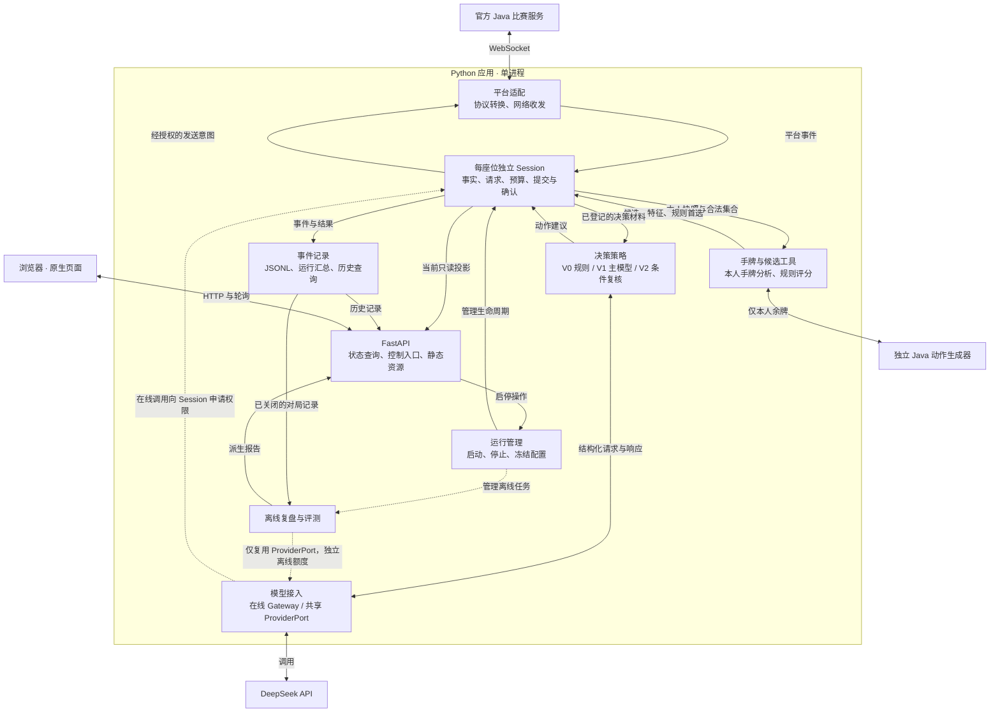
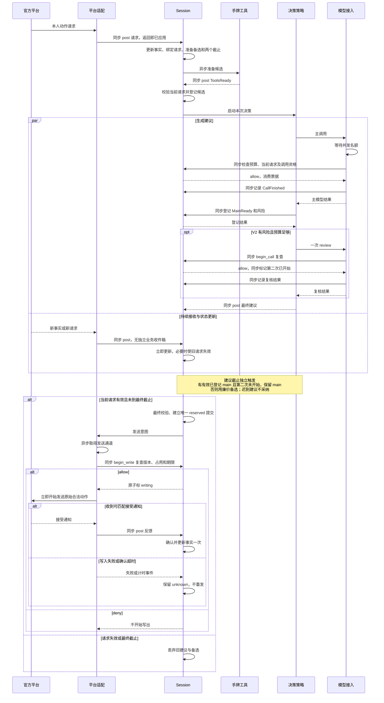
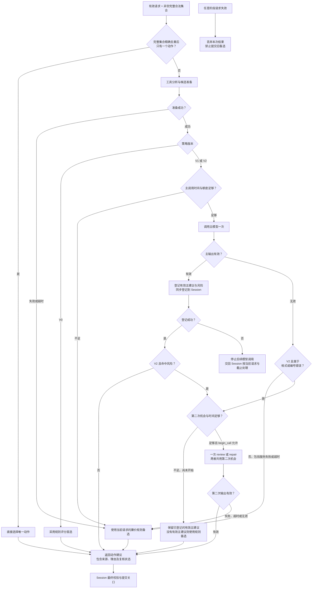

# 掼蛋 Agent 架构与技术选型

> 公开版本说明：本文中标为“原工作区”的材料未随仓库提供；可公开核对的内容见[证据说明](evidence/README.md)。

版本：v1.7，课程项目精简架构及事实语义修复。更新日期：2026-10-19，Asia/Shanghai。

## 1. 架构结论与范围

第一版采用 **官方 Java 比赛服务 + 单进程 Python 应用 + 本地浏览器页面**。Python 内部按职责划分模块，每个参赛座位拥有独立的对局 Session；LangGraph 负责一次动作请求的决策，提交权限集中在 Session 的程序校验关口。

在线策略提供 V0 规则基线、V1 工具辅助单次 LLM、V2 条件复核三个版本。模型使用已完成小样本实测的 DeepSeek；手牌分析采用规则与限时启发式，不训练模型。运行状态保存在内存，过程证据写入 JSONL，赛后汇总写入 JSON。展示采用 FastAPI/Uvicorn 与原生 HTML、CSS、JavaScript。

本文包含 [开发流程](开发流程与阶段产出.md) 阶段四的模块、数据流、状态归属、异常责任和选型决策，以及阶段五确定的目录与接口映射。架构是待实现的设计；阶段三的实际证据完整保留在附录 A。新增网页模块、完整平台与模型联调、最终策略强度均未完成验证。

本版保持功能范围，简化同步状态处理、日志和工具失败路径；完整模型整场验收集中到最终评测。具体字段、函数签名、HTTP 路径和协议映射已在 [需求与接口规格](需求与接口规格.md) 第 8—13 节统一，源码目录与协作面见本文第 13 节。B01—B09 已建立在线闭环、Web、离线复盘权限/生成与统计；真实流程已验证，但复盘事实质量未通过抽查。分层证据在实施计划第7.6—7.11节，附录A阶段三历史保持不变。

图示入口：第 3.3 节总体架构、第 5.3 节运行时时序、第 7.1 节决策分支。三张 Mermaid 图作为本文件的一部分维护；模块职责、调用顺序或分支条件变化时，同一次文档变更同步更新对应图和文字。图示为设计总览，详细约束以接口规格为准，不能视为已完成的运行验证。

## 2. 选型所依据的事实

| 阶段三事实 | 本阶段设计决定 |
| --- | --- |
| 官方 Java WebSocket 服务已完成 1 整场、15 小局、1328 次提交及通知匹配 | 保留独立 Java 服务，Python 通过 WebSocket 接入；不重写整套游戏引擎 |
| 候选外 PASS 和旧动作重放仍被服务端处理 | 客户端负责当前合法集合、请求有效性及重复提交检查 |
| 断线后同座位加入被拒绝 | 首版断线记为中断，不设计自动恢复原比赛或重发旧动作 |
| Java 动作引擎 smoke 通过；Python 固定首局后跨局异常 | 可复用独立动作生成器，不把完整 Python Table 作为主线比赛环境 |
| 三个固定合成局势完成四次真实 DeepSeek 请求，包含一次复核 | 采用 ChatDeepSeek + JSON mode + 本地校验，复核保留配置开关 |
| 当前源码没有牌桌页面 | 自建最小只读牌局与决策面板，保留以后接入教师界面的可能 |

补充读取已有正常对局日志发现，1300 个出牌请求的合法动作数量中位数为 2、最大为 1593，其中 612 个请求只有一个动作。因此需要保留完整合法集合用于校验，同时限制传给模型的候选规模。该统计来自一场对局，不是普遍分布或性能基准；来源为附录 A 的四座位原始消息。

课程是否允许外部模型 API、正式时限和教师平台版本尚未确认。这里确定的是本地课程项目方案，不把实验的 20 秒单次等待、30 秒总预算设为正式比赛标准。

## 3. 运行组成与技术选择

### 3.1 运行组成

- **Java 比赛进程：** 使用固定版本官方服务，维护游戏实际状态、动作请求和结算。本地验证仅监听回环地址。
- **Python 应用进程：** 一个事件循环管理平台连接、各座位 Session、决策任务及展示接口。可运行一个比赛中的多个独立座位，首版不并发开展大规模赛事。
- **动作生成工作进程：** 由手牌工具管理的独立 Java JAR（故障后本次运行停用），只计算给定本人手牌的可首出组合，不接触比赛服务器内部状态。
- **浏览器页面：** 展示指定座位的可见局势、决策结果与历史记录，通过只读轮询获取更新；启动和停止属于独立控制操作。
- **离线复盘任务：** 批次结束后手动启动的独立任务，读取已关闭日志，输出报告；不进入在线图，不自动改写策略。

### 3.2 技术选型表

| 领域 | 第一版选择 | 选择理由与限制 | 证据状态 |
| --- | --- | --- | --- |
| 比赛服务 | 官方 Java WebSocket 快照，JDK 21、Maven | 沿用课程平台规则与消息；接入缺陷由客户端防护，未验证拒绝语义不自行假设 | 已构建并完成真实规则对局 |
| 应用语言与环境 | Python 3.12、uv、独立环境 | 复用现有验证工具，便于状态、LLM 和统计处理 | 已用于阶段三 |
| 通信与并发 | asyncio + websockets | 网络与模型等待期间持续接收消息；CPU/阻塞操作不得直接卡住事件循环 | WebSocket 客户端已验证；完整并发设计待实现 |
| Agent 编排 | LangGraph StateGraph，每请求独立运行 | 统一普通、复核、兜底和作废分支，图只输出建议 | 核心离线分支及固定局势真实调用已验证 |
| 模型 | ChatDeepSeek，默认 deepseek-flash，thinking 关闭 | 已跑通；显式 JSON mode，自动重试为零；保留模型配置入口 | 四次真实请求通过，非稳定性保证 |
| 数据校验 | Pydantic 与程序化候选校验 | 类型和结构校验与游戏动作校验分别执行 | 探针中已验证，完整业务结构已定义、待实现 |
| 手牌规则 | Python 计数与启发式；按需调用独立 Java 动作生成器 | 使用本人手牌产生组合，避免依赖有跨局问题且含四家暗牌的 Table | 动作生成 smoke 通过；评分质量与耗时待验证 |
| 展示后端 | FastAPI + Uvicorn，单 worker | 与异步运行管理共处一个进程，提供静态页面及状态查询 | B01 已锁版安装并完成 import/进程内检查，产品接口与页面待 B08 |
| 展示前端 | 原生 HTML/CSS/JavaScript，低频轮询 | 满足牌桌、状态、理由和日志浏览，控制前端工程量 | 本阶段选定，尚未实现 |
| 当前状态 | 每座位独立内存状态 | Session 单一写入，模型拿不可变快照；重启不恢复旧比赛执行 | 本阶段设计 |
| 证据存储 | JSONL 事件记录 + 派生 JSON 汇总 | 本地小规模便于审查、复盘与重算；首版不引入数据库或 Redis | 验证脚本已用文件记录，正式写入管理待实现 |
| 复盘与评测 | 离线 Python 任务 | 与在线运行解耦，复盘失败不阻塞比赛，评测从确认结果汇总 | 功能待实现 |

已验证 Python 依赖以 [阶段三锁定清单](../experiments/phase3/requirements.lock.txt) 为起点。B01 已将 FastAPI 0.146.0/Uvicorn 0.54.0 写入正式 uv.lock 并完成本地兼容性检查；产品服务和页面联调尚未执行。[FastAPI 异步说明](https://fastapi.tiangolo.com/async/)、[静态文件支持](https://fastapi.tiangolo.com/tutorial/static-files/)

应用正式运行时使用单 worker，并关闭自动 reload，避免内存状态分裂、重复建立座位连接或运行中被重启。新增框架不是新增独立业务服务；一切仍按单机课程项目组织。

### 3.3 总体架构图

本图展示模块职责和主要连接，浏览器、比赛服务及动作生成器分别位于 Python 应用进程之外。Session 是每座位事实、请求、预算和提交状态的唯一写入者。



模型给建议，工具给分析；实际提交与确认仍由 Session 管理。为保持图示清晰，省略了各模块写日志的重复连线。M05 内部的 ProviderPort 只负责一次供应商传输；在线 Gateway 经 CallPort 授权并校验动作，离线 Reviewer 经 RunManager 的独立任务额度授权并校验报告。离线不使用在线 binding/CallPort 或两次调用额度，也不与在线决策共用可写状态；这是现有 M05 内的复用，不新增服务。

## 4. 模块职责、输入输出与权限

以下模块是职责划分，不直接等于目录或类。调用者通过小范围接口使用模块，其内部实现可继续拆分。

| 模块 | 输入 | 输出 | 独占职责与修改权限 | 异常责任 |
| --- | --- | --- | --- | --- |
| M01 运行管理与对局 Session | 启停指令、平台事件、策略建议、模型调用申请与结果 | 可见快照、请求预算、提交决定、执行结果、展示投影 | 每座位事实、请求生命周期和执行状态的唯一写入者；调度工具/策略任务并拥有提交关口 | 请求作废、提交占用、预算、确认等待与迟到确认、停止和断线中断 |
| M02 平台适配 | 连接配置、原始消息、经 Session 授权的提交意图 | 按座位归属的规范化事件、发送结果及连接状态 | 隐藏协议差异，负责实际网络读写；不选择牌、不自行重试业务动作 | 解析失败、连接失败、协议未知与反馈匹配信息 |
| M03 手牌规则与候选工具 | 本座位快照、完整合法集合、工具预算 | 候选及原动作映射、规则备选、结构特征、分析降级原因 | 只计算派生数据；管理动作生成工作进程；初版不要求缓存 | 工具超时、故障工作进程清理与本次运行降级、候选异常及保留规则 |
| M04 决策策略 | 固定可见快照、完整合法集合、策略配置与受限预算能力 | 候选准备结果、主建议、复核建议、最终建议或作废原因、过程事件 | 消费完成唯一判断与工具准备的已登记材料，执行 unique/V0 规则分支或 V1/V2 LangGraph；只修改本次决策草稿 | 输出无效、复核分支和图异常，失败交回 Session |
| M05 模型调用 | 经在线/离线调用者分别授权的上下文、期限与模型配置 | ProviderPort 的原始文本/用量/安全错误；在线 Gateway 的结构化决策 | 密钥仅供该模块运行时使用；共享一次传输，在线动作校验与离线报告校验分开，无隐藏重试 | 服务错误、空内容、解析错误、超时和迟到响应 |
| M06 事件记录 | 来自各模块且已注明归属的事件 | JSONL 证据、有限历史查询、记录完整性状态 | 单一路径写日志；不修改牌局事实，不独立推断胜负 | 文件失败、队列积压、末尾不完整记录及缺失标记 |
| M07 展示与控制入口 | Session 只读投影、记录查询、用户启停操作 | 页面、状态展示、受校验的启停指令 | 不持有密钥或平台连接，不直接出牌、不直接改 Session | 页面失败、无效操作、重复启动和轮询延迟 |
| M08 复盘与评测 | 已关闭日志、确认结算、冻结实验配置 | 关键回合分析、统计结果和用量说明 | 只生成派生报告；不得覆盖源日志、在线状态或策略配置 | 缺失证据、模型失败、无法核算费用与不完整样本 |

Session 内部的动作执行关口统一处理模型建议、规则备选和唯一合法动作。它不成为第二份状态存储。平台适配模块只负责协议和网络，规则评分与模型提示不依赖原始 WebSocket 消息结构。

真实平台适配与日志/模拟事件回放、真实模型与固定响应是实际存在的替换场景。只为这些场景保留接口，不设计通用插件注册中心或多供应商管理平台。

## 5. 数据流与一次决策走查

### 5.1 在线数据流

> 平台消息 → 平台适配 → 对应座位 Session 更新事实 → 生成不可变快照 → Session 检查唯一合法动作，必要时调度工具并登记材料 → 决策策略产生规则或模型建议 → 建议回到 Session → 提交关口 → 平台适配发送 → 平台反馈 → Session 确认结果。

各步骤同时产生归属明确的日志事件。展示读取 Session 投影和有限历史，评测读取确认结果与原始记录；二者都不能反向修改对局事实。

主决策与复核共享同一快照和候选映射。阶段五将工具准备的任务调度落实到 Session；计算仍属于 M03。工具准备结果通过事件交给 Session，经请求归属检查后登记为不可变决策材料，M04/Graph 读取这些材料继续执行。候选编号由本次准备过程分配，提交时还原为该请求原始完整动作；不使用模型返回的自由牌组，也不按新请求重新解释旧编号。

### 5.2 示例走查

以下是设计走查，使用阶段三“对手剩一张”的输入场景说明协作，不能视为完整系统已经联调：

1. Session 收到本人有效请求，记录比赛、小局、座位、连接代次和接收时刻，生成本次决策快照。
2. 工具保留合法过牌及满足拦截条件的压制选项，计算本人剩余手牌特征，准备一个确定性的备选。
3. 主 Agent 选择过牌。风险检查发现对手临近走完，且还有第二次调用和时间预算，进入一次复核。
4. 复核改选候选中的炸弹。Graph 返回建议和理由，不发送动作。
5. Session 确认原请求仍有效、连接未更换、完整动作仍合法且未占用提交机会，然后占用本次提交机会并发送。
6. 收到与当前待确认动作相符的服务端通知后，Session 更新已确认事实和执行结果，日志与页面随之更新。

若步骤 3—5 之间请求失效，建议和备选一并作废。若复核失败但请求仍有效，则返回规则备选，经过同一提交关口执行。

### 5.3 单次出牌运行时时序图

下图展示有效主建议与可选复核的正常路径。平台事实、停止和异步结果都回到同一事件循环，短同步处理后才返回；等待工具/模型时接收循环仍继续运行。



Stop 与新请求进入本地处理入口后立即生效，不存在“已入队但还未应用”的窗口。工具与模型都在外部任务等待，Session 内不得 await 或做阻塞计算。运行关闭前可靠迟到确认可以补记；关闭时仍未知的保留未知，不提供日志修订链。

## 6. 状态归属与并发规则

### 6.1 三类状态

| 状态 | 权威来源及写入者 | 可读取范围 |
| --- | --- | --- |
| 平台事实与当前执行状态 | 平台提供事实；对应 Session 串行更新。事实包括本人手牌、公开历史、级牌、剩余张数；执行状态包括活动请求、预算、提交占用和确认结果 | 通过只读快照交给策略，通过受限投影交给页面 |
| 决策草稿与模型判断 | 当前 Graph 运行内生成，结果以事件返回 Session；不能直接覆盖事实 | 当前主决策、复核和该座位日志 |
| 历史证据与派生报告 | 事件记录模块追加源事件；复盘和评测生成独立报告 | 按比赛和座位受控查询，离线统计可使用完整实验记录 |

每个比赛座位只有一个 Session 写入事实和执行状态。多个座位即使位于同一进程，也不能共享可写手牌对象或模型对话历史。观察其他座位在页面上的内容，不改变在线策略的信息权限。

### 6.2 持续接收与同步单写

每个座位连接只有一个接收循环，取得帧后同步解析并调用 Session.post，返回即完成状态更新；没有独立的 Session 业务收件箱。Stop、计时器、工具和模型结果同样在此事件循环短同步处理，不递归处理事件、不等待外部资源。

模型、Java、文件 I/O 和发送通道等待在外部任务完成，结果回到 Session 时检查原请求绑定。HTTP 控制入口在同一事件循环同步应用停止；工作线程不直接修改事实。这样简化入队/应用双序号和 defer 等待，同时保留已处理事件的先后关系。

Java 调用受工具总预算约束；超时后停止派发并有限终止/清理该进程，本次 run 停用深度分析。当前请求可使用廉价备选，以后请求可用廉价特征；不在场内自动重建，不让当前决策等待恢复。下次显式启动 run 再初始化，初版不建设复杂缓存。

每座位只有一个有效请求。新请求、相关事实变更、停止、断线或结算立即使旧任务失效；尽量取消任务，安全性仍依赖实际调用/发送前的版本和期限检查。

Session 先准备廉价备选；Graph 在复核前同步登记有效 main 和风险，不占提交机会。到建议截止，保留“有效 main 且第二次未开始”的建议，否则用备选；到最终截止禁止新发送。第二次开始状态由 begin_call 同步置位。已写出记录仍等待确认，超时只标未知。

### 6.3 请求、重复与提交

本地需要把比赛、小局、座位、连接代次、活动请求与候选快照关联起来。对应 RequestBinding、RequestContext 和 CandidateSnapshot 的字段与版本规则见接口规格第 8 节。

- 与本次决策有关的状态变化使快照失效；纯日志更新和页面浏览不递增决策有效性版本。
- 能证明属于同一事件或请求的重复消息只处理一次，不重新分配调用预算；相同牌面不等于相同事件。
- 当前协议缺少可靠服务器请求号时，本地序号只提供本地归属，不能声称服务器具有幂等保障。无法确认消息先后或状态时，按不可信状态处理。
- 提交关口在同一串行操作中检查有效性并占用提交机会，避免模型与超时兜底同时发送。占用后不再允许第二个建议替换决定。
- 实际网络写出或模型调用开始前，在同一事件循环同步复查活动请求、占用归属、连接和期限。若此前同步处理过新请求或 Stop，旧资格已经失效；取得外部通道后再复查，允许后立即开始副作用。未写出意图可取消，写入开始后失败可能结果未知，不释放占用重发。
- 平台反馈由 Session 根据原比赛、小局、座位及提交记录匹配待确认动作；不盲目关联历史相同牌面。提交截止或决策快照失效不取消对已发送动作的确认处理。首版默认不自动业务重提，因为其拒绝和重提语义尚未充分验证。

发送资格与确认等待分别管理。动作已发送或可能已发送后，Session 保留提交记录，并按独立的确认等待预算观察平台反馈。等待超时只标记“结果未确认”，不清除记录、不释放重发资格；此后若仍收到能够可靠匹配的确认，可补记已确认结果。若新权威快照已包含该动作的影响，只补记确认，不重复扣牌或覆盖新小局的当前状态。无法可靠关联的反馈保留为待核对证据，不猜测匹配。确认等待时间和记录保留策略见接口规格第 10.3、12.3 节，平台是否接受动作始终以其反馈为准。

该设计保证客户端已知状态下的提交一致性，不能保证服务器不存在尚未送达的变化，也不能提供跨网络的绝对一次执行承诺。

### 6.4 跨决策记忆与重启

每次动作请求重新运行一份 Graph 状态，跨回合记牌由 Session 的结构化状态维护，不能只依赖不断增长的模型消息历史。新小局重新建立全部局内事实：本人手牌和张数来自 beginning，其他张数为未知；清空出完顺序、领先者/动作、公开历史及裁剪计数、贡还缓存与猜测，展示阶段重置 waiting。两队级别先置未知，待下一 act 刷新，本局级牌取 levelCard。旧活动请求/候选/主建议解除，旧票据与未写出意图失效；历史调用/提交账本、已占额度和已发送确认索引继续保留。请求序号、状态/展示版本跨小局递增，旧确认只能补历史，不污染新局；未知张数遇出牌通知仍为未知，不做减法。详细清单见接口规格第 9.1 节。

首版不把持久化 Graph checkpoint 用于恢复在线发送或补调模型。JSONL 可以用于离线回看；进程重启后，未完成 Session 标记中断，不根据旧记录重放动作。LangGraph 的持久化能力不能替代比赛平台的状态恢复接口。[LangGraph 持久化说明](https://docs.langchain.com/oss/python/langgraph/persistence)

## 7. LangGraph 决策流程

Graph 的范围是“一次请求的建议生成”，从准备好的当前快照开始，到返回建议或作废结果结束。WebSocket 接收、权威状态更新、实际发送和确认均在图外。

### 7.1 决策分支流程图

本图包含图外的唯一动作、工具准备和 V0 分支，以及 LangGraph 内的主模型、路由、复核/修复和建议返回。发送关口始终位于 Session 中。



任意节点发现请求失效都转作废分支；该全局条件未逐一连到每个节点。第二次调用在并发排队中耗尽时间、尚未成功 begin_call 时，仍按 Keep 分支处理；请求失效则直接丢弃。建议截止后不接受 Graph 的迟到返回，由 Session 使用已登记 main 和 second_call_started 决定保留 main 或规则兜底。图中第二次调用没有回边，修复后不能再做战术复核。

### 7.2 节点职责与分支约定

| 逻辑节点 | 执行方式 | 职责与结果 |
| --- | --- | --- |
| 请求检查与唯一合法动作判断 | Python | 先检查请求、预算和平台完整合法集合；空集合停止，只有一项时直接生成建议，跳过后续工具与模型，仍须进入最终校验 |
| 工具分析与候选准备 | Python / 受控动作引擎调用 | 仅对非唯一合法动作请求计算特征、筛选候选并准备规则备选 |
| 策略选择 | Python | V0 返回规则建议；V1/V2 进入主决策 |
| 主决策 | 一次 LLM 请求 | 从候选中选动作，返回理由；输出异常只产生失败结果 |
| 风险与预算路由 | Python | 有效主建议先计算风险并同步登记到 Session；再决定 V2 复核、保持主建议或兜底。无效主输出不登记，可在预算内修复 |
| 复核或修复 | 最多一次 LLM 请求 | 在同一候选集合中维持或改选；修复与战术复核共用第二次机会 |
| 建议校验 | Python | 检查建议结构、候选映射和本地有效性；仍由 Session 在实际提交前终检 |
| 规则兜底 | Python | 使用当前请求关联的规则备选，或在已失效时返回作废 |
| 结束 | Python | 返回建议、来源、原因、调用记录；无平台发送副作用 |

**分支约定：**

| 情况 | 结果 |
| --- | --- |
| 平台完整合法集合精确去重后仅一项 | 在手牌分析之前直接选择，零次动作引擎与 LLM 调用，仍走建议校验和最终提交关口；仅筛选后剩一项不能冒称平台唯一合法动作 |
| 主建议有效且无风险 | 校验建议后返回 |
| V2 多个风险同时触发且预算足够 | 合并一次复核，不递归复核 |
| V2 输出无效且还有第二次机会 | 进行一次修复，不能修复后再发起额外战术复核 |
| V1 输出无效，或主调用失败/超时 | 规则兜底，不隐藏重试 |
| 复核没有成功 begin_call 且时间不足（包括并发等待到建议截止） | 保留已登记有效主建议并记 skipped；在截止处由 Session 选择，不采纳迟到图结果。没有有效主建议则规则兜底 |
| 复核已经启动但失败或超时 | 规则兜底，不再调用模型 |
| 任何阶段请求作废 | 返回作废，旧规则备选也不再有效 |

阶段三探针能作为这些路径的测试参考，但不能直接将其合成候选判断、局部时间起点或模拟有效性对象当成正式平台接口。

## 8. 手牌工具与三种策略

### 8.1 候选准备

平台完整合法集合由 Session 保留。Session 在调度工具前完成唯一合法动作判断，唯一时交给策略直接产生建议；非唯一时，工具生成其子集和映射。先按出牌数量、剩余牌数、散牌、拆组合及公开局势等便宜特征排序，再对有限候选进行更细的剩余结构评估。候选数量和深评上限已在接口规格第 12.3 节给出本地初值，实际耗时仍待验证。

完整合法集合先按原始三元数组精确 JSON 值去重，保留来源下标及原数组；唯一捷径依据去重完整集合，不能依据 Top-K。正常 V0 的工具评分首选和建请求时的廉价备选可不同，分别记录 rule 与 fallback；V1/V2 共享同版评分和备选。合法过牌、全部直接走完和需求规定的关键压制选项按保留规则优先加入，不能为了固定 Top-K 静默丢掉。必要选项超过模型输入预算时，降级规则选择并记录原因。

剩余组合估计需要“剩余本人手牌可首出的组合”，不能用当前跟牌列表替代。优先复用独立 Java 动作生成器，在给定手牌和级牌下生成组合，再做有预算的贪心分解或简化评分。分析生成的组合不得加入平台当前合法集合，规则备选也只能来自该请求原始合法集合。初版不要求缓存；后续测得有必要时仅按本人牌面计数和规则条件缓存，模型不能读取其他座位私牌或 Table。

不对每个大规模候选都做无限枚举。动作生成工作进程不可用或超时时，立即采用便宜特征和规则备选，标明未完成结构分析，不谎报最少手数；工作进程按第 6.2 节的停用与清理约定处理，不仅取消外层等待。

### 8.2 V0、V1、V2 的共享部分

- V0 使用确定性规则评分；同输入和同配置应稳定选出同一动作，便于作为基线和兜底。
- V1 使用相同候选和工具结果，最多请求主模型一次。
- V2 与 V1 共用主模型、候选和兜底，仅增加条件复核。
- 进贡、还贡沿用同一阶段识别和合法集合校验。唯一选项直出；存在多个选项时允许配置的策略处理，不在模型中另造规则。

自动恢复工作进程、专门缓存和日志修订链均延期；不以实现这些机制作为主 Agent 接入的前置。训练、微调、复杂树搜索、队友私牌预测器均不作为首版依赖。手牌评分改进与候选筛选效果通过后续对照实验验证。

## 9. 时间、调用量与异常责任

### 9.1 统一预算

预算归属于一次有效请求，由 Session 创建并维护，不能在 Graph 节点或复核角色切换时重置。模型调用模块发起请求前申请并占用名额，实际失败尝试也计数；Graph 保存调用结果用于展示，不是另一份独立预算权威。

V0/V1/V2 的在线调用上限分别为 0/1/2。底层模型自动重试关闭；实际请求数与逻辑次数一起记录。每座位只有一个有效决策，全局模型并发受限，等待并发名额也计入本次决策时间。

总时间从有效请求被本地接收开始计算，包含解析、工具、模型并发等待、复核、校验和发送余量。建议生成截止为最终提交截止减去校验与发送预留，watchdog 也在此前者触发，按已登记主建议与第二次调用是否开始决定保留 main 或规则兜底，不能等最终期限才处理。模型等待不超过建议生成截止；最终期限一到，连规则备选也不能新发送，但此前已发送动作仍按独立确认等待规则处理。教师时限未知时，使用明确标记的本地实验预算，不依据四次调用的中位数设置正式保证。

运行管理同时维护批次级模型调用上限和可用预算，离线复盘单独记账。批次额度不足时禁止新模型请求：尚未开始复核且已有有效主建议则保留 main 并记 skipped，否则当前有效请求规则兜底；两种预算影响分别记录。不静默修改策略版本或删去这类实验样本。费用无法准确核算时，以可执行的请求次数和输入输出规模限制控制调用，费用仍记为未知，不宣称已实现精确金额封顶。

首版保留复核开关。阶段四选定有界预算机制；具体工具时间、模型时间、提交预留和并发数量已在接口规格第 12.3 节配置，实际值仍需经集成实验调整。

### 9.2 异常责任表

| 异常 | 主要负责模块 | 处理方式 |
| --- | --- | --- |
| 无有效请求、空合法集合、状态矛盾 | Session / 平台适配 | 不发模型请求或猜测动作；尝试以可信平台信息核对，否则中断 |
| 工具或动作生成器超时 | 手牌工具 | 停止派发并有限清理进程，本次 run 停用深评；当前请求降级，旧结果弃用 |
| 模型服务失败、超时、输出无效 | 模型调用 / 决策策略 | 保留失败类型及用量可得性，按 V1/V2 分支有限修复或兜底 |
| 请求在模型等待期间变化 | Session | 使旧请求失效；结果即使有效也不提交 |
| 发送失败或确认不明 | Session / 平台适配 | 保留提交记录与占用，确认等待超时标为未确认；可靠迟到确认仍可补记，不重发、不重复扣牌 |
| 断线或应用退出 | 运行管理 / Session | 作废决策、关闭自己的连接、记录中断；下次运行新建 Session |
| 日志失败或积压 | 事件记录 | 采用有界队列和有限缓冲，提示记录不完整；不阻塞出牌无限重试，不伪造证据 |
| 页面刷新或查询失败 | 展示模块 | 显示断开或数据更新时间，重新查询；查询不得重启 Agent 或重复出牌 |
| 复盘失败 | 离线任务 | 保留源日志，标记复盘未完成，不影响在线状态或下一局 |

## 10. 展示、记录与离线分析

### 10.1 最小页面

页面包含运行状态、四个座位及公开剩余张数、当前观察座位的手牌、桌面动作、决策理由、复核修改和历史决策列表；另有已生成复盘的报告列表、正文/状态和原决策引用跳转。自动 PK 模式不扩展人工出牌、账号或社交功能。

前端通过低频只读轮询获取最新投影，按版本替换显示，显示数据时间与执行确认状态。查询从有限内存索引或分页历史读取，不能每次刷新扫描所有日志。模型等待期间页面仍可查询；不展示模型完整思维链，只展示返回的简短理由。

用户启动、停止和选择策略通过控制入口交给运行管理模块校验，不能由浏览器直接发送游戏动作。策略及模型配置在一次运行开始时冻结，更改只对新运行生效。重复启动不得产生相同座位的多条连接。

### 10.2 文件记录

首版只维护脱敏 config.json、追加 events.jsonl、结束时生成的 summary.json 和独立 reports/。每座位事件带归属，查询按 session_id 过滤；原始结算用于派生成绩，汇总不是第二份游戏事实。

记录器可使用小的有界写入缓冲；失败/积压立即标不完整，不无限重试或阻塞出牌。结束时有限等待并关闭一次，未确认动作和未知用量照实保留。进程异常退出或残缺尾行不能被当成成功记录。无父 manifest、补充证据版本链或封存后自动修订。

运行关闭后不再修改源对局日志；离线报告和它自己的调用用量另存。密钥不进入配置快照、模型上下文、页面或日志。普通查询首次加载所需历史后使用有限内存结构，暂不建设通用磁盘索引。

### 10.3 复盘与评测

B09/V25修复增加一个共享纯函数语义模块，在线与离线均从平台牌码/状态翻译明确含义。新离线事实由程序生成，模型仅提供分析建议；报告读取时对照源记录重算事实，展示来源与核验状态。旧模型归纳保持原样，核验不延伸到模型判断或策略收益。详见[事实语义修复记录](事实语义修复记录.md)。

首版复盘以独立命令在对局批次结束后读取已关闭日志，生成关键回合及建议；命令通过统一运行入口登记和启动任务。在线 Session 不等待复盘完成。默认不同时运行在线比赛与自动复盘；运行管理启动下一批时，停止由它管理的未完成复盘任务并标记未完成，不等待远端模型返回。已经发出的请求是否计费按实际证据记录，不能承诺取消就免费。

复盘读取每回合“当时可见”的快照，将后来发生的结果单独列出。生成内容不能修改源事件、权重、提示词或冻结的测试配置。界面读取已有报告，区分当时事实与事后结果，并按程序校验得到的 run/session/request 归属跳转原决策；缺失证据显示不可定位。打开、刷新报告或点击引用均不发模型调用、不产生动作；生成仍由离线命令启动。

评测使用相同对手、队友和预算配置比较 V0/V1/V2，明确小局与整场统计单位，列出中断、未确认及已判负样本。当前不支持固定整场发牌，因此初版结果不能宣传为严格整场配对实验；后续若实现可复现发牌，需重新验证实际牌局对应关系。

## 11. 架构决策记录

| 决策 | 采用方案及依据 | 代价与后续调整条件 |
| --- | --- | --- |
| D01 保留官方服务 | 已验证正常对局链路，主线通过 WebSocket 接入 | 客户端承担当前已发现的校验缺口；教师版本变化时调整平台适配 |
| D02 单进程、单 worker | 共享运行管理但隔离各座位 Session，减少部署和状态同步工作 | 不用于大规模并行比赛；达到实际性能瓶颈后再考虑拆分 |
| D03 一次请求一张决策图 | Graph 专注建议生成，Session 管事实和副作用 | 需要定义结果回传与作废约定；持久化图不是断线恢复方案 |
| D04 工具与模型分工 | Python/Java 负责组合和校验，DeepSeek 负责候选权衡 | 启发式评分需评测；复杂工具超时必须能降级 |
| D05 条件复核 | 真实固定局势已走通第二次请求，需求有明确关键场景 | 增加调用与延迟；规则或时限不合适时关闭 |
| D06 自建最小网页 | 当前服务无可用牌桌，FastAPI 便于和异步应用组织在一起 | 新增 UI 待联调；保持纯展示投影，教师提供界面时可替换 |
| D07 内存加文件 | 当前规模可以用内存状态和基本记录覆盖 | 不承诺跨进程在线恢复；需要多进程共享查询时再评估数据库 |
| D08 离线复盘 | 与在线决策隔离，用日志支撑解释 | 报告有延迟，复盘意见不等于策略正确性证明 |

## 12. 需求覆盖与接口映射

| 需求 | 主要模块 | 阶段五接口已覆盖的内容 |
| --- | --- | --- |
| F01 平台接入 | M01、M02 | 启停、身份、消息转换、阶段识别和连接失败表示 |
| F02 状态与记牌 | M01 | 快照、事件归属、版本变更、贡还牌更新及重复判定 |
| F03 手牌工具 | M03 | 输入信息范围、完整合法集合与候选的关系、必要选项保留和工具预算 |
| F04 主决策 | M04、M05 | 模型输入投影、输出结构、有效候选检查与失败表示 |
| F05 条件复核 | M04、M05 | 风险触发、共享快照、第二次机会及预算不足时的返回 |
| F06 校验兜底 | M01、M02、M03 | 提交占用、最终校验、待确认和未确认的转换规则 |
| F07 界面与日志 | M06、M07 | 只读投影、查询分页、控制指令、事件字段及记录缺失 |
| F08 赛后复盘 | M08、M05 | 已关闭的对局输入、当时/事后信息、离线调用预算和报告关联 |
| F09 对战统计 | M08、M06 | 冻结配置、结果来源、统计分母、用量缺失与样本归属 |

阶段四明确了模块权限和异常责任；阶段五已将上表落实为接口规格第 8—13 节，并在下节确定目录。B01 已按实施计划建立独立的基础源码、测试和配置；探针目录继续保留为历史实验。

实验复现说明见 [阶段三实验目录](../experiments/phase3/README.md)。

仍需向课程方确认外部 API 许可、正式时限、平台版本和展示要求。这些问题已有临时处理，不影响本地接口设计，但最终比赛配置不能提前写成已确认事实。

## 13. 项目结构与开发协作（阶段五）

### 13.1 目录基线

以下是完整目标目录。**B01—B09 已建立在线策略、Web、offline/review.py与evaluate.py；runtime/offline.py维护独立预算和取消。recording/query.py与reports.py提供缓存读取；risk.py为纯程序风险，在线提示仍在gateway.py**。已有研究和阶段三材料继续独立保留，不创建空业务模块或据此声称可启动对局。M01—M08 是同一 Python 包内的职责，不是八个独立服务。

```text
gundan/
├── pyproject.toml                 # 后续声明 Python 3.12 与应用依赖
├── uv.lock                        # 正式环境建立时生成，新增依赖先验证
├── .env.example                   # 空密钥占位；实际 .env 保持本地忽略
├── configs/
│   └── local.example.toml         # 非敏感配置，字段见接口规格 §12.3
├── src/guandan_agent/
│   ├── contracts.py               # 公共不可变数据、枚举和返回类型
│   ├── config.py                  # 校验、加载、脱敏冻结与 config_id
│   ├── clock.py                   # 同一进程单调时钟与手动测试时钟
│   ├── app.py                     # 依赖组装与应用生命周期；单 worker
│   ├── cli.py                     # 运行/离线入口，复用 RunManager
│   ├── runtime/                   # M01：manager.py、session.py、私有事实 state.py、scheduling.py
│   ├── platform/                  # M02：port.py、openguandan.py、scripted.py
│   ├── hand/                      # M03：candidates.py、features.py、java_engine.py
│   ├── strategy/                  # M04：policy.py、graph.py、rules.py
│   │   └── prompts/               # main/review/repair 文本及版本
│   ├── model/                     # M05：gateway.py、provider.py、deepseek.py、scripted.py
│   ├── recording/                 # M06：events.py、query.py
│   ├── web/                       # M07：api.py 与 static/{index.html,app.js,style.css}
│   └── offline/                   # M08：evaluate.py、review.py
├── tests/
│   ├── contracts/                 # 类型、映射、枚举、隔离和版本约束
│   ├── unit/                      # 规则、候选、状态、预算和统计
│   ├── integration/               # 脚本平台/模型，以及显式启用的真实接入
│   └── fixtures/                  # 脱敏原始帧、脚本结果、虚拟时钟案例
├── scripts/
│   └── prepare_platform.py        # 后续抽取可复用构建逻辑；不导入探针业务
├── runtime/                       # 构建 JAR/动作引擎缓存，生成物，不提交
├── runs/<run_id>/                  # config.json、events.jsonl、summary.json、reports/
├── docs/                          # 本项目规格、架构、后续计划与合成示例
├── experiments/phase3/            # 已完成验证及证据，保留原来可复现方式
└── research/                      # 来源与固定源码快照，不作运行时 Python 包
```

`runtime/` 根目录是生成物目录，`src/guandan_agent/runtime/` 是运行管理源码，使用时写明完整相对路径。B01 的 `.gitignore` 已增加 `.venv/`、根 `/runtime/`、`/runs/`、`/artifacts/` 等生成物规则；不要用无前缀 `runtime/` 误忽略源码。报告交付只选择脱敏证据，不把整场所有私牌日志默认提交。当前已存在的实验结果继续作为研究证据保留。

只固定包和公共入口，内部文件可按实现规模合并。首版不建立通用 repository、event-bus、插件注册器或多供应商框架。真实/脚本平台、DeepSeek/固定响应是必要的两组替换实现；虚拟时钟用于确定性检验期限，应用代码不导入 tests。

### 13.2 接口到目录的对应

| 模块/公共入口 | 目录 | 接口规格位置 | 测试入口 |
| --- | --- | --- | --- |
| 公共结构与配置 | contracts.py、config.py | §8、§12.3 | 类型拒绝、配置冻结、凭证排除 |
| M01 RunManager / Session | runtime/ | §10.1—10.3 | 平台事件→请求→提交→确认；T04—T06、T11—T13 |
| M02 PlatformPort | platform/ | §9、§10.1 | 原始消息映射、贡还和重复；T07、T11 |
| M03 HandTools | hand/ | §8.3、§10.4 | 必要候选、重复牌、超时/停用；T01、T08 |
| M04 DecisionPolicy | strategy/ | §11 | 主决策/复核/修复/兜底分支；T02、T03、T10 |
| M05 ModelGateway / ProviderPort | model/；CallPort 与在线/离线额度权威仍在 runtime/ | §10.1、§10.3、§11 | 真实/脚本单次传输、无隐式重试；在线预算 T10/T12/T13；离线无 binding、额度隔离 |
| M06 EventStore | recording/ | §12.1、§12.4 | 基本写入、日志缺口、关闭和分页；T09 |
| M07 HTTP / 页面 | web/ | §12.2 | 单座位投影、只读查询、start/stop；报告阅读/原决策跳转不新增调用 |
| M08 Evaluator / Reviewer | offline/ | §12.4 | 结算去重、分母、未知用量、证据引用 |

依赖方向：`contracts` 不导入业务模块；`hand/strategy` 不导入 WebSocket/网页/RunManager；策略只拿本请求 CallPort 和在线 Gateway；只有 Gateway/离线 Reviewer 复用 ProviderPort，策略不能绕过 Gateway 直接传输；平台不导入策略；model 不读取其他 Session；web 把控制交给 RunManager、查询交给只读投影与 EventStore；offline 只读已关闭的对局记录。`app.py` 负责把具体实现连接起来，避免模块通过全局单例寻找其他座位状态。

Session 保留生命周期、版本、预算、提交和确认的唯一写权限。接口采用即时同步事件处理和短的同步 gate，不引入第二个“执行状态服务”。EventStore 只持证据，网页和 summary 不维护平行的胜负/手牌权威。

### 13.3 三人协作面

| 建议责任组 | 负责范围 | 可以先用什么独立开发 |
| --- | --- | --- |
| A：平台与运行 | M01/M02、公共 contracts/config、平台构建入口 | 原始帧 fixture + ScriptedPlatform + 虚拟时钟；先接完整规则流程 |
| B：规则与 Agent | M03/M04/M05、提示词 | 固定 RequestContext/CandidateSnapshot + ScriptedModel + 受限 CallPort；先验证预算/分支再接真实模型 |
| C：记录与展示 | M06/M07/M08 | 已保存 LogEvent 和已关闭日志及配置；实现单座位查询、页面、复盘/统计 |

模块所有权沿用上表；阶段六 [实施计划](实施计划.md) 已将角色落实到任务、依赖和验收，实际人员姓名与日历安排仍待确定。共同结构由 A 统一维护，B/C 通过契约提变更，不各自复制一份 Request/Action。联调使用 [合成契约样例](examples/phase5-contract-example.json) 和接口规格 T01—T13，完整输入、输出及预期分支须一起变更。原始 `WireAction` 的生成/发送协议归 A，B 只能引用既有 action_id；这样三方不会各自重写一套动作解释。

### 13.4 从探针迁移的范围

- `probe_platform.py` 提供已验证原始消息和确认路径的参考；正式实现另补单写 Session、两层期限、写出前复查、接收者/阶段确认，不能原样复制成产品服务。
- `probe_model.py` 的显式 JSON mode、严格输出、固定响应和零隐藏重试可迁移；合成局势、局部时间起点与探针 RequestLease 不能替代本项目的真实请求绑定。
- 动作引擎仅使用本人手牌输入的独立 Java 调用；Python Table 不进入正式依赖。源快照保持不改，构建副本与 JAR 放根 runtime，构建步骤记录固定 SHA 和 JDK 21。
- 阶段三已验证依赖保留证据，B01 已建立独立 pyproject/uv.lock 并验证新增 FastAPI/Uvicorn；阶段三 lock 继续作为历史证据，不替代正式依赖锁。

阶段五的完成标志是契约与目录能够支撑独立开发和 Mock 联调设计。B01—B09工程流程已验证至P21；真实复盘输出存在事实解读错误，内容质量未通过，后续须修正或披露。P22—P24按[实施计划](实施计划.md)推进最终评测与交付。HTTP Mock、合成场景模型输出、真实平台确认链和最终整场比较仍是不同证据。

## 附录 A 阶段三验证证据

以下保留 2026-10-19 的实际实验记录。它们支撑技术可行性与当前限制，不代表上文全部模块已经实现。

### A.1 验证对象与环境

| 项目 | 实际使用值 |
| --- | --- |
| 官方源码 | `GameAI-NJUPT/OpenGuanDan-Simulator` |
| 固定提交 | `e92db7fa9d915fb318b3be78703d5ccd4a09c887` |
| 本地原始快照 | `research/sources/OpenGuanDan-Simulator-e92db7f/` |
| 运行机器 | macOS arm64 |
| Java / Maven | JDK 21.0.11 / Maven 3.9.16；构建显式指定 JDK 21 |
| Python | 独立虚拟环境，Python 3.12.13 |
| Python 依赖 | websockets 15.0.1、LangGraph 1.2.16、langchain-deepseek 1.1.1、Pydantic 2.14.1 |
| 服务地址 | `ws://127.0.0.1:18181`，本地验证端口 |
| 源码适配 | 只在实验副本中把监听地址改为 127.0.0.1，未更改游戏逻辑 |
| 实测模型 | DeepSeek `deepseek-flash`，thinking 关闭；四次真实请求 |

来源：环境记录（原工作区 `experiments/phase3/results/environment.json`）、[依赖锁定清单](../experiments/phase3/requirements.lock.txt)、源码适配记录（原工作区 `experiments/phase3/results/source-adaptation.json`）。原始研究快照未修改。Maven 构建成功只证明产物可构建，平台运行结论来自下面的对局实验。

教师未提供其他版本或比赛限制，本次验证的是用户同意使用的本地官方快照，不等于最终课程比赛服务器。

### A.2 平台实际验证

#### A.2.1 完整规则对局

四个独立 WebSocket 客户端分别使用自己的动作请求选择合法动作。策略不读取其他座位日志或真实手牌。创建房间时请求运行一整场，最终四个座位都收到 `gameResult` 与 `gameOver`。

| 实际观察 | 数量或结果 |
| --- | --- |
| 完成整场 | 1 |
| 小局结算 | 15 |
| 出牌或过牌提交 | 1,300 |
| 进贡提交 | 14 |
| 还贡提交 | 14 |
| 提交总数 / 匹配到处理通知数 | 1,328 / 1,328 |
| 抗贡 | 3 次事件；四座位广播合计 12 条通知 |
| 首局实际级牌 | 2 |

动作确认依据是提交座位连接收到的通知：出牌匹配玩家与动作内容；贡还牌匹配结果中的发出座位与牌。它证明当前受控实验中的消息衔接，不是服务端动作合法性校验的保证，也不证明复杂重发场景具备强幂等语义。

证据：[正常对局摘要](../experiments/phase3/results/probe_platform_run_02/normal/summary.json)、[动作事件记录](../experiments/phase3/results/probe_platform_run_02/normal/events.jsonl)。各座位原始消息与摘要同目录保存。

#### A.2.2 独立异常实验

每项实验使用独立本地房间；异常动作不混入正常对局成绩。

| 实验 | 实际观察 | 对后续实现的影响 |
| --- | --- | --- |
| 提交首出列表没有的 PASS | 收到该动作的处理广播，后续玩家获得请求 | 服务端提供候选不等于严格拒绝候选外输入；客户端必须校验 |
| 重放同座位上一请求的旧动作 | 新请求候选已无该动作，但重放后仍收到处理通知 | 请求版本与候选绑定必须由客户端维护，不能依赖服务端拒绝旧动作 |
| 活跃座位断线后以同身份、同座位加入 | 返回 `code=-1`、房间已满；未收到恢复状态或动作请求 | 当前测试路径不支持恢复原座位；首版应记录中断，不能盲目重发 |
| 首次动作等待约 5 秒 | 窗口内无推进；随后原合法动作获处理通知 | 只能说明该窗口未观察到超时，不能推断无时限或课程时限 |

证据：非法动作（原工作区 `experiments/phase3/results/probe_platform_run_02/invalid/summary.json`）、旧动作重放（原工作区 `experiments/phase3/results/probe_platform_run_02/replay/summary.json`）、[断线重入](../experiments/phase3/results/probe_platform_run_02/disconnect/summary.json)、等待窗口（原工作区 `experiments/phase3/results/probe_platform_run_02/timeout/summary.json`）。

静态源码另发现会话引用比较与发送者绑定检查的疑点，具体位置见 [源码审计](../experiments/phase3/source_audit.json)。跨座位冒用没有运行测试，不把静态发现写成该场景已复现。当前没有修改服务端校验或重连逻辑。

### A.3 动作引擎与固定发牌验证

Java 动作引擎构建成功。官方 Python smoke 脚本成功完成先手动作解析、跟牌 PASS 检查及一段随机走子：smoke 日志（原工作区 `experiments/phase3/results/bridge-smoke.log`）。该脚本不是完整规则正确性证明或性能基准。

额外使用固定的 108 张牌序和固定首家创建两个 Python 环境：两次初始牌分配一致，每人 27 张。随后仅依据当前玩家请求进行 88 次动作选择，完成第一个小局。

进入下个小局的 `enter_tribute_stage` 时实际抛出 `IndexError: list index out of range`。静态代码显示固定牌堆分支没有填充跨局洗牌使用的内部基础牌堆，与此失败路径一致。

证据：固定发牌与跨局结果（原工作区 `experiments/phase3/results/bridge/summary.json`）、原始消息（原工作区 `experiments/phase3/results/bridge/messages.jsonl`）。

因此当前只能确认 **Python bridge 的固定首局可复现**，不能声称固定整场可用。Java WebSocket 对外协议未发现固定牌堆或种子入口；这是当前源码接口检查结论，未验证通过额外修改服务器实现配对发牌。两个环境应分别记录，不互相代替验证结论。

### A.4 模型与 LangGraph 验证

#### A.4.1 已运行的离线部分

使用真实安装的 LangGraph 构建准备输入、主决策、条件复核、最终校验和规则兜底流程，但模型响应由模拟器提供，未连接比赛执行端。

15 项离线测试通过，覆盖普通决策、多风险合并复核、非法编号修复、两次失败后兜底、V1 不修复、等待超时、过期响应、调用失败、唯一输入候选、空候选和显式隐藏信息字段过滤等。另用本地 HTTP MockTransport 检查实际 DeepSeek 适配器发出的请求参数与 HTTP 500 时不自动重试。

三个合成局势的图运行产生四次模拟调用，其中一次复核，外部网络请求数为零。这里的“唯一输入候选”不等于比赛平台只有一个合法动作，完整合法集合的判断应在后续平台适配中完成。

证据：测试日志（原工作区 `experiments/phase3/results/model-tests.log`）、模拟运行摘要（原工作区 `experiments/phase3/results/model-simulated/summary.json`）、模拟决策记录（原工作区 `experiments/phase3/results/model-simulated/decisions.jsonl`）。

#### A.4.2 DeepSeek 接入方式

采用 `ChatDeepSeek` 的显式 JSON mode，关闭适配器隐藏重试，再做本地结构与候选校验。DeepSeek 官方说明 JSON Output 保证 JSON 语法，仍可能返回空内容，因此不能省略本地验证。[DeepSeek JSON Output](https://api-docs.deepseek.com/guides/json_mode/)

模型名依据官方说明选择 `deepseek-flash`，本次关闭 thinking；模型名和模式可以在实验参数中调整。[DeepSeek 模型说明](https://api-docs.deepseek.com/quick_start/pricing/)、[LangChain DeepSeek 集成](https://docs.langchain.com/oss/python/integrations/chat/deepseek)

首次无密钥时保存了 blocked 记录（原工作区 `experiments/phase3/results/model-blocked/summary.json`），它只对应此前零请求的尝试。用户补充配置后，由本地验证进程加载密钥并完成下述实测；私有配置存于被 Git 忽略的 `.env`，空的 [.env.example](../.env.example) 保留供后续配置参考。探针只读进程环境，不启用外部追踪。

#### A.4.3 固定局势真实调用结果

三个局势各运行一次，使用相同的合成候选输入。模型主请求和复核均经真实 DeepSeek API 返回，动作只在探针中校验，未提交比赛平台。

| 局势 | 实际请求数 | 结果 | 探针决策总耗时 |
| --- | ---: | --- | ---: |
| 普通跟牌 | 1 | 有效候选，经主决策完成 | 888.054 ms |
| 对手剩一张牌 | 2 | 触发一次复核，将过牌建议改为候选中的炸弹 | 1618.401 ms |
| 队友领先 | 1 | 选择过牌，未触发额外复核 | 765.182 ms |

四次请求均得到有效结构和候选编号，三次决策均成功选出候选，无兜底、过期或缺失用量。单次请求耗时范围为 **761.961–884.734 ms**，中位数 **807.5365 ms**。这些时间包含网络、模型包装器和解析；决策总耗时包含图流程，但不包含比赛平台通信和动作提交，也不是长期延迟分布。

接口报告输入 **1937 Token**、输出 **144 Token**，合计 **2081 Token**。当前没有账单或经核对的单价计算，费用保持未知；不能把未知写成零。适配器重试设为零，实际观测四次传输请求，没有通过重试突破调用预算。

该结果确认了本批输入下的真实 API、JSON 解析、候选校验和条件复核路径。复核改变了建议，不代表已经证明它更正确或能提高胜率；模型理由里的局势判断仍需实战评价。没有进行训练、完整 LLM 对局或策略强度评测。

证据：真实请求摘要（原工作区 `experiments/phase3/results/model-live-run-01/summary.json`）、逐决策记录（原工作区 `experiments/phase3/results/model-live-run-01/decisions.jsonl`）、耗时与用量汇总（原工作区 `experiments/phase3/results/model-live-run-01/analysis.json`）。

本轮单次等待上限 20 秒、总决策预算 30 秒是探针配置，不是课程时限。三个局势的小样本足以确认接入路线可运行，不足以设置正式性能承诺；阶段四可以保留在线复核，但应支持按实际时限关闭或跳过。

### A.5 展示能力验证

当前源码树只有动作引擎、Python bridge 和 Java WebSocket 服务，没有牌桌前端资源。对实际服务 `http://127.0.0.1:18181/` 发出普通 HTTP GET，返回 400，正文提示缺少 WebSocket upgrade。

证据：HTTP 根路径结果（原工作区 `experiments/phase3/results/http-root.json`）、[静态审计](../experiments/phase3/source_audit.json)。这不是界面视觉验收；结论限定于本次源码服务，不能推断其他发布包或教师平台也没有界面。

据此，本阶段选择自建基础牌局与决策日志面板，保留后续替换展示模块的可能。当前不将现成平台界面列为已可复用依赖，新增页面尚待实现。

### A.6 Q01—Q08 状态与临时方案

| 问题 | 状态 | 结论或缺口 | 当前处理 |
| --- | --- | --- | --- |
| Q01 外部 API 许可 | 待确认 | 用户确认教师尚未说明；课程 PDF 未明确许可 | 本地技术实验与课程参赛许可分开记录 |
| Q02 协议与可见信息 | 本地快照已验证，教师版本待确认 | 已连接并覆盖出牌、贡还牌、抗贡与结算；策略只用当前座位请求 | 以该快照作为本地验证基准，之后核对课程版本 |
| Q03 接受、拒绝和过期处理 | 部分已验证 | 观察到通知确认；部分非法与旧动作未被拒绝，未证明所有拒绝语义 | 自行做合法集合、请求有效性及提交状态检查 |
| Q04 断线恢复 | 测试路径不支持 | 同座位重入被拒绝，没有恢复状态 | 标记该局中断，不重放旧动作 |
| Q05 时限与模型表现 | 核心调用路径已验证，比赛时限待确认 | 15 项离线测试通过；三个合成局势完成四次真实请求及一次复核，单次约 0.76–0.88 秒 | 可据此进入架构设计；不将小样本和本地 5 秒观察窗口当作正式时限保证 |
| Q06 结算口径 | 正常路径已验证 | 观察到 15 次小局结算与整场终局；异常判负语义仍未明确 | 正常与异常实验分别记录，无权威结算不补造胜负 |
| Q07 固定发牌 | 部分支持，整场受限 | Python 固定首局一致，跨局复现异常；WS 没有现成固定发牌接口 | 首批对战记录实际条件，不宣称严格整场配对 |
| Q08 牌桌展示 | 当前源码不提供现成页面 | 源码无前端、HTTP 根路径非页面；课程展示要求待确认 | 本阶段选择最小网页，尚待实现 |
